  

  

  
  

## `01` About

  

## `02` Projects

  
  
  
  
  
  

Also: <a href="https://github.com/chuyong-1/multi-agent-debate-langgraph">multi-agent debate</a> · <a href="https://github.com/chuyong-1/Social-to-Lead-Agentic-Workflow">social-to-lead agent</a> · <a href="https://github.com/chuyong-1/Voice-Controlled-Local-AI-Agent">voice-controlled local agent</a> · <a href="https://github.com/chuyong-1?tab=repositories">all repos →</a>

## `03` Stack

<table>
<tr><td nowrap><code>LLMs&nbsp;&&nbsp;agents</code></td><td>
       
</td></tr>
<tr><td nowrap><code>ML&nbsp;&&nbsp;vision</code></td><td>
        
</td></tr>
<tr><td nowrap><code>Retrieval&nbsp;&&nbsp;data</code></td><td>
      
</td></tr>
<tr><td nowrap><code>Backend&nbsp;&&nbsp;apps</code></td><td>
       
</td></tr>
<tr><td nowrap><code>Infra&nbsp;&&nbsp;tools</code></td><td>
     
</td></tr>
</table>

## `04` Activity

  

<picture>
  <source media="(prefers-color-scheme: dark)" srcset="https://raw.githubusercontent.com/chuyong-1/chuyong-1/output/github-snake-dark.svg" />
  <source media="(prefers-color-scheme: light)" srcset="https://raw.githubusercontent.com/chuyong-1/chuyong-1/output/github-snake.svg" />
  
</picture>

## `05` Beyond code

District boxing gold medalist, state bronze, national-level competitor. Founded and led the Martial Arts & Self Defence Club at Manipal University Jaipur, growing it to 200+ students.

